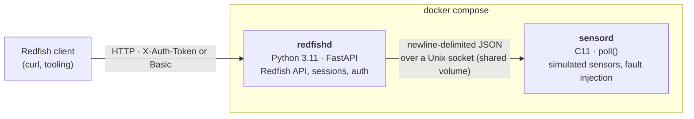

# mini-bmc

[](https://github.com/ccoliu/mini-bmc/actions/workflows/ci.yml)

A small, self-contained simulator of a server **BMC** (Baseboard Management Controller):
a C daemon that simulates sensors and faults, a **DMTF Redfish** REST API on top of it, and
a CI pipeline that checks every response against the official Redfish schemas and runs
DMTF's own Redfish Service and Protocol Validators against the shipped containers.
No hardware required: `docker compose up` and talk to it with `curl`.



## Highlights

- **C systems code** – a `poll()`-based Unix-socket daemon with a bounded JSON parser that
  answers malformed input with an error instead of crashing. Unit-tested with Unity, run under
  AddressSanitizer + UBSan, checked with cppcheck and gcov/lcov, built with `-Werror`.
- **Standards conformance** – every Redfish resource and error body is validated against the
  official DMTF JSON schemas (Redfish-Publications 2026.2, pinned by tag and SHA-256). The test
  crawls the API from the service root and hard-codes no URLs, so a dangling link also fails.
  On top of that, CI runs DMTF's own conformance tools against the shipped containers: the
  Service Validator on the response bodies, with faulted sensors and finished update Tasks in
  place, and the Protocol Validator on HTTP behaviour (headers, status codes, sessions, TLS),
  which reports no failures.
- **Fault injection end to end** – overheat a CPU sensor in the C daemon and the Redfish
  chassis reports `HealthRollup: Critical`. Freeze a sensor and, after ten unchanged readings,
  the daemon flags it as stuck and Redfish reports `Warning` with a DMTF `SensorEvent`
  condition. Stop the daemon and the API answers `503` with `Retry-After`, then recovers on its
  own when the daemon returns.
- **Security basics done deliberately** – HTTPS only: like a real BMC on its first boot, the
  container creates a self-signed certificate once and keeps it, and every client in CI
  verifies against it rather than skipping the check. Random session tokens that are separate from public
  session IDs, constant-time credential checks, and a test that walks every route and fails if
  any endpoint outside a small allowlist answers without credentials. Containers run as
  non-root on a read-only filesystem with all capabilities dropped, and `sensord` has no
  network at all.
- **Firmware update with rollback** – a Redfish multipart push update with SHA-256 image
  verification, A/B slots with crash-safe writes (fsync, atomic rename), and a trial boot that
  commits the new image or rolls back automatically. It runs as a Redfish Task, so the BMC keeps
  serving sensors during the update, and an interrupted update is rolled back at startup.
- **CI on every push** – 4 GitHub Actions jobs covering C build and analysis, Python lint
  (ruff), type checks (pyrefly), unit tests, integration tests against both a release and an
  ASan build of the daemon, and a Docker Compose smoke test plus both DMTF validators against
  the shipped images.

## Quick start

Requires Docker with Compose v2.

```sh
docker compose up --build --wait        # REDFISH_PORT=18000 if port 8000 is taken
# HTTPS only, with a certificate the BMC made itself on first start: copy it out and trust it
docker compose cp redfishd:/var/lib/redfishd/tls/cert.pem mini-bmc-ca.pem
REDFISH_CA=mini-bmc-ca.pem scripts/smoke_test.sh   # 9 end-to-end checks, incl. a firmware update
```

Then explore. The demo credentials are `admin` / `admin`; set `REDFISH_PASSWORD` to change
them. The port is bound to `127.0.0.1` only.

```sh
export CURL_CA_BUNDLE=$PWD/mini-bmc-ca.pem   # curl verifies the BMC against its certificate
BASE=https://127.0.0.1:8000/redfish/v1

curl -s $BASE/ | jq                                   # service root: the only public resource
curl -s -o /dev/null -w '%{http_code}\n' $BASE/Chassis/1          # 401 without credentials

# Log in: the token comes back in a header, never in the body
TOKEN=$(curl -s -D - -o /dev/null -X POST $BASE/SessionService/Sessions \
          -H 'Content-Type: application/json' \
          -d '{"UserName": "admin", "Password": "admin"}' |
        awk 'tolower($1) == "x-auth-token:" {print $2}' | tr -d '\r')
AUTH="X-Auth-Token: $TOKEN"

curl -s -H "$AUTH" $BASE/Chassis/1/Sensors/cpu_temp | jq '{Reading, ReadingUnits, Status}'

# Inject a fault into the C daemon and watch it surface through Redfish
scripts/sensordctl.sh '{"cmd": "inject_fault", "sensor": "cpu_temp", "mode": "overtemp"}'
curl -s -H "$AUTH" $BASE/Chassis/1 | jq .Status      # HealthRollup: "Critical"
scripts/sensordctl.sh '{"cmd": "clear_faults"}'

# A silent failure: a frozen sensor looks fine until the daemon sees it stop changing
scripts/sensordctl.sh '{"cmd": "inject_fault", "sensor": "inlet_temp", "mode": "stuck"}'
sleep 11      # ten unchanged readings at the default 1 s tick
curl -s -H "$AUTH" $BASE/Chassis/1/Sensors/inlet_temp | jq .Status   # Warning + Conditions
scripts/sensordctl.sh '{"cmd": "clear_faults"}'

# Power the host off through a Redfish action
curl -s -o /dev/null -w '%{http_code}\n' -H "$AUTH" -X POST \
     -H 'Content-Type: application/json' -d '{"ResetType": "ForceOff"}' \
     $BASE/Systems/1/Actions/ComputerSystem.Reset            # 204
curl -s -H "$AUTH" $BASE/Systems/1 | jq .PowerState         # "Off"

# Update the BMC firmware: build an image, push it, follow the task
PYTHONPATH=redfishd python3 scripts/make_fw_image.py 1.1.0 -o fw.bin  # --fail-selftest: rollback
TASK=$(curl -s -H "$AUTH" -F 'UpdateParameters={}' -F 'UpdateFile=@fw.bin' \
       $BASE/UpdateService/upload | jq -r .Id)                             # 202 Accepted
sleep 5      # verify, install into the spare slot, simulated reboot, self-test, commit
curl -s -H "$AUTH" $BASE/TaskService/Tasks/$TASK | jq '{TaskState, Messages: [.Messages[].MessageId]}'
curl -s -H "$AUTH" $BASE/UpdateService/FirmwareInventory/BMC | jq .Version  # "1.1.0"
```

`docker compose down -v` stops everything.

## What is implemented

| Resource | Notes |
|---|---|
| `/redfish/v1/` service root | Public, like `$metadata` (CSDL) and the OData service document `/redfish/v1/odata`. Everything else requires authentication. |
| `Chassis/1`, `Chassis/1/Sensors/{id}` | 3 temperature sensors, 2 fans, 1 PSU. Uses the current `Sensor` model, not the deprecated `Thermal` resource. A stuck sensor is `Warning` with a `Status.Conditions` entry. Health rolls up to the chassis. `Sensors?$expand=.` returns every reading in one request, from one daemon read. |
| `Systems/1` + `ComputerSystem.Reset` | Simulated host power. 7 reset types, advertised through `@Redfish.AllowableValues`. |
| `SessionService` | Login (`X-Auth-Token` + `Location`), logout, 30-minute idle timeout. HTTP Basic is accepted too. |
| `AccountService` | The one account (from the environment) and DSP0266's predefined roles `Administrator`, `Operator` and `ReadOnly` with their exact privileges. Read-only: every write is `405`. The account carries an `ETag`, the same in the header and in `@odata.etag`, derived from its content. |
| `UpdateService` | Multipart push update (`MultipartHttpPushUri`). The image is verified before any Task exists: a bad one gets `400` with an `Update` registry message saying why, an oversized one `413`, a second concurrent update `409`. |
| `UpdateService/FirmwareInventory` | `BMC` (the running firmware) and `BMC_Backup` (the other A/B slot: `Absent`, `Updating` during a trial boot, or `StandbySpare` holding the previous version). |
| `TaskService/Tasks/{id}` | Long-running operations. The task monitor answers `202` while the task runs and `200` when it is done. Messages come from the DMTF `TaskEvent` and `Update` registries. The 32 most recent tasks are kept. |
| Query parameters | `$expand` (`*`, `.`, `$levels=1`) on the Sensors collection, advertised in `ProtocolFeaturesSupported`. Any other `$` parameter is `501`, `$expand` anywhere else `400`; unknown parameters without `$` are ignored, as DSP0266 requires. |
| HTTP headers | `OData-Version` (a request for another version is `412`), `Cache-Control: no-cache`, `Allow` on every GET, and `Link: <schema>; rel=describedby` naming the DMTF schema of each resource. A POST to `Sessions/Members` logs in like one to `Sessions`. |
| Errors | Always a Redfish error body using DMTF Base registry messages, for 400, 401, 404, 405, 409, 412, 413, 500, 501 and 503 alike. |

`sensord` simulates `cpu_temp`, `gpu_temp`, `inlet_temp`, `fan1_rpm`, `fan2_rpm` and
`psu_watts`, with four fault modes: `overtemp`, `stuck` (a silent failure, detected from the
values alone), `disconnected` and `noise`. The socket protocol is specified in [CLAUDE.md](CLAUDE.md#interface).

## Testing strategy

Each layer catches a different class of bug. 415 tests in total, all run in CI.

| Layer | Tool | Count | Catches |
|---|---|---|---|
| sensord unit | Unity (C), under ASan + UBSan | 36 | Parser edge cases, buffer bounds, threshold and fault logic, stuck detection without false positives |
| redfishd unit | pytest + a fake sensord | 272 | Error mapping, auth and sessions (with an injectable clock), query-parameter rules (a route walk, like the auth one), protocol headers, action validation, image parsing, crash recovery of the A/B store, readers racing an update thread, task lifecycle |
| Integration | pytest against the real daemon, release and ASan builds | 107 | Protocol over a real socket, malformed input, client limits, signals, stale sockets, every fault mode observed through Redfish and cleared, sensors staying readable during a firmware update |
| Conformance | DMTF JSON schemas, part of the integration suite | (17) | Wrong property names, invalid enum values, broken links, in healthy, faulted, stuck and powered-off states, and for completed and rolled-back update Tasks |
| Smoke | `scripts/smoke_test.sh` against `docker compose` | 9 | Problems that only show up in the shipped images and wiring |
| Service Validator | DMTF `rf_service_validator` against `docker compose` | 1 run, ~380 property checks | Anything the DMTF CSDL schemas define that our JSON-schema tests miss, plus `$metadata` itself, checked by DMTF's own tool rather than ours |
| Protocol Validator | DMTF `rf_protocol_validator` against `docker compose` | 1 run, ~240 assertions | HTTP behaviour the body checks cannot see: missing headers, wrong status codes, session rules, account ETags. Its first run found 7 such bugs. It is held to a list of known failures, each with its reason; a new failure fails CI, and so does a known one that starts passing, so the list cannot go stale. Adding the roles, then TLS, proved that rule: each time the check demanded the entry be removed. The list is now empty |

The checks are complementary. For example, the DMTF schema accepts any string for
`ReadingUnits`, so only a unit test catches `"C"` where Redfish requires UCUM `"Cel"`.

A nightly pipeline runs all of this again with the integration suite repeated five times under
each daemon build, to catch tests that only fail sometimes. It is a workflow in
[Coworkify](https://github.com/ccoliu/coworkify), defined in [ops/coworkify](ops/coworkify):
dispatch CI, wait for it with a sensor that holds no worker, then report to Discord. CI turns
each failed test into a GitHub annotation, with how many of the runs it failed in. A red night
is reported from those facts first; a [Codoctopus](https://github.com/ccoliu/Codoctopus) agent
step on a local model follows with a second, labelled message, so a model that is down cannot
hide a failure. A green night sends a message too, so silence means the pipeline itself broke.

## Design decisions

- **Unix socket with one JSON object per line** between C and Python: trivially testable with
  any tool, and no network surface. redfishd opens one connection per request, so a daemon
  restart needs no reconnect logic, and every exchange shares a single timeout so a hung daemon
  cannot hang the API.
- **A stale socket is removed only on `ECONNREFUSED`.** Any other connect error proves nothing
  about liveness, so the daemon refuses to start rather than delete another instance's socket.
- **Responses are plain dicts; the official schemas are the oracle.** Redfish keys such as
  `@odata.id` fit models poorly, and validating against DMTF's own schemas is a stronger check
  than validating against models written for this project. The 35 schema files the tests
  need are vendored. The full closure through `$ref` would be 1,324 files.
- **`$metadata` is generated from the same table that sets every `@odata.type`.** A new
  resource type cannot be served without being declared in the CSDL document. The Service
  Validator reads the CSDL schemas from the same pinned DMTF release as the JSON schemas
  (extracted at CI time, not committed: about 80 MB), and never downloads whatever release
  dmtf.org publishes next, so a DMTF update cannot turn CI red overnight.
- **Authentication is a FastAPI dependency, not path-matching middleware.** Routing decides what
  is protected, and a route-walk test catches any new endpoint that forgets the dependency. It
  is `async` on purpose: plain `def` dependencies run in a thread pool, and the session store is
  not thread-safe.
- **An unreadable sensor makes the chassis `Warning`.** Losing monitoring is itself a problem,
  so it is never reported as `OK`.
- **Stuck sensors are detected in the daemon, from the values alone.** A healthy sensor jitters
  every tick, so ten identical full-precision values in a row mean it has frozen. redfishd only
  sees values rounded to 0.1, where a healthy `inlet_temp` repeats a quarter of the time, and
  does not know the tick rate, so it could not tell the two apart. Detection never looks at the
  injected fault, and a unit test proves it by freezing a sensor that has no fault at all.
  The daemon reports `stuck` next to the threshold `status`; redfishd decides that a frozen
  value is at least `Warning`.
- **Firmware goes into the inactive slot, and `state.json` is the commit point.** Every write is
  a temporary file, `fsync`, then an atomic rename, and the state is updated first to say the
  target slot is being rewritten. A power cut at any point leaves either the old firmware
  running or the new one on trial, which is rolled back at startup. A damaged active slot falls
  back to the other one; a damaged `state.json` stops the service rather than guess.
- **In memory, the firmware state is one immutable snapshot, published after it is saved.**
  Each change builds a new frozen object, writes it to disk, then swaps one reference, and
  readers take the snapshot once. That beats a lock here: readers follow no rule they could
  forget, and nothing is held across an fsync. See the race below for why it exists.
- **Verify synchronously, install asynchronously.** A bad image is rejected in the HTTP
  response, before any Task exists. Only an image that will really be installed gets a Task,
  and its blocking file I/O runs in a worker thread so the event loop keeps serving requests.

## Bugs found along the way

Two concurrency bugs, both found, proven and fixed the same way: make the rare interleaving
happen on demand, fix the cause rather than the timing, then show the new test fails without
the fix.

- **A race in the firmware store.** The update runs in a worker thread
  (`asyncio.to_thread`) while HTTP handlers read the same state on the event loop.
  `boot_trial()` set the active slot and cleared the trial flag in two steps, so a reader
  could see a state that never exists: the same slot both active and on trial. A stress test
  with `sys.setswitchinterval(1e-6)` (one thread updating, one reading) turned the rare case
  into thousands of bad reads per run. Fixing it surfaced a second bug: memory changed before
  `state.json` was written, so if the write failed, the API reported a version that a restart
  would roll back. The fix is the snapshot design above. Both regression tests were checked by
  putting the bug back: splitting the commit fails the stress test, and publishing before
  saving fails a disk-full test.
- **A flaky CI test.** The firmware-update integration test failed only on the ASan job, and
  only sometimes. It read the backup slot (`Updating`), then the active slot, as two separate
  requests, and the background commit could land between them. Widening the gap between the
  two requests made it fail every time. The fix reads the active slot first: the commit flips
  both together, so if the backup still shows the trial afterwards, the earlier read predates
  the commit. No sleep, no retry.

## Known limitations

These are deliberate simplifications for a simulator, not oversights. The TLS certificate is
self-signed and there is no `CertificateService` to replace it with one from a real CA. A
single account comes from environment variables, and there is no lockout or rate limiting on
login. The roles are published but not enforced: with a
single Administrator account, no request could be refused for lack of a privilege. Sessions and Tasks live in memory and do not survive a
restart (the installed firmware does). The SHA-256 in an image's manifest proves integrity
(the upload was not damaged), not authenticity: anyone who can log in can build a valid image.
A real BMC would verify a signature against a key in its root of trust. There is one updatable
component, the BMC itself, and the "reboot" is a timed wait plus a self-test flag in the image.
Plain HTTP is not served at all, so the Protocol Validator cannot send it the HTTP request it
uses to check that Basic auth and logins require HTTPS: it marks those two checks not tested.

## Roadmap

- [x] `sensord`: C daemon, fault injection, sanitizers, coverage, static analysis
- [x] `redfishd` MVP: Redfish resources, sessions, schema conformance, Docker Compose, CI
- [x] Firmware update via `UpdateService`: checksum verification, rejecting corrupt images,
      automatic rollback, Redfish Tasks
- [x] Serve `$metadata` and run the DMTF Redfish Service Validator in CI
- [x] `$expand` on the Sensors collection, and the DMTF Redfish Protocol Validator in CI
- [x] `AccountService` with the predefined roles (read-only)
- [x] HTTPS with a self-signed certificate made on first start; no Protocol Validator failures
- [ ] Nightly regression scheduled by Coworkify, with failures triaged by a Codoctopus agent step

## Development

Linux or WSL2. One virtualenv covers every Python tool.

```sh
make -C sensord && make -C sensord test && make -C sensord sanitize
python3 -m venv .venv && .venv/bin/pip install -e "./redfishd[dev]"
(cd redfishd && ../.venv/bin/pytest)            # redfishd unit tests
.venv/bin/pytest                                # integration + conformance
.venv/bin/ruff check . && .venv/bin/pyrefly check
# DMTF validators against the Compose stack (reports in validator-report/, protocol-report/):
python3 -m venv /tmp/dmtf && /tmp/dmtf/bin/pip install redfish_service_validator==3.1.8 \
    redfish-protocol-validator==1.3.2
export REDFISH_CA=mini-bmc-ca.pem     # copied out of the stack, as in Quick start
RSV=/tmp/dmtf/bin/rf_service_validator scripts/service_validator.sh
RPV=/tmp/dmtf/bin/rf_protocol_validator scripts/protocol_validator.sh
```

Layout: `sensord/` (C daemon), `redfishd/` (FastAPI app), `tests/` (integration and
conformance, plus the vendored schemas), and `scripts/`. [CLAUDE.md](CLAUDE.md) holds the
detailed specification and conventions.

## License

MIT. `sensord/third_party/unity` is [Unity](https://github.com/ThrowTheSwitch/Unity) (MIT).
The files in `tests/redfish_schemas/` are published by [DMTF](https://www.dmtf.org) and carry
DMTF's copyright notice. This project is not affiliated with DMTF.
